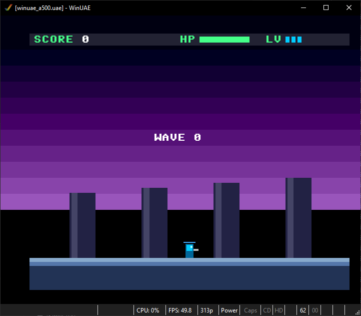
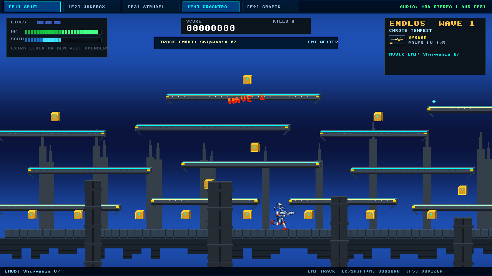
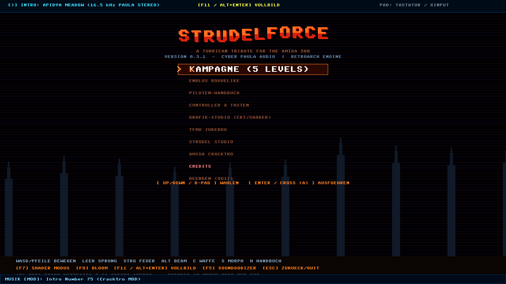
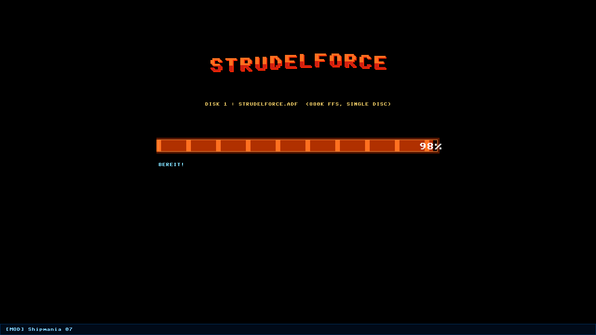

# 🚀 STRUDELFORCE 0.3.1 (Consolidated Monolith)

[](https://en.wikipedia.org/wiki/Amiga_500)
[](#)
[](https://github.com/Tretboot/STRUDELFORCE/releases/tag/v0.3.1)
[](#)
[](#)
[](#)
[](#)
[](#)
[](LICENSE)

> **"Amiga 500 trifft Cyber-Paula & 2.5D-Voxel-Action (Turrican-Hommage)."**  
> Ein kompromissloser Retro-Action-Shooter auf Amiga-Hardware-Restriktionen (512 KB Chip-RAM, OCS/AGA Bitplanes, Copper-Listen), Chris Hülsbecks legendärer **TFMX Professional Sound-Engine**, ProTracker MOD, TidalCycles/Strudel Live-Coding und richtungsbeschatteten 2.5D-Voxeln.

### 📦 Offizieller Release-Download: [v0.3.1](https://github.com/Tretboot/STRUDELFORCE/releases/tag/v0.3.1)
* **Windows x64 Paket:** [`strudelforce-v0.3.1-windows-x64.zip`](https://github.com/Tretboot/STRUDELFORCE/releases/download/v0.3.1/strudelforce-v0.3.1-windows-x64.zip) (nur `strudelforce.exe` & `strudelforce_game.exe`)
* **Linux x64 Paket:** [`strudelforce-v0.3.1-linux-x64.zip`](https://github.com/Tretboot/STRUDELFORCE/releases/download/v0.3.1/strudelforce-v0.3.1-linux-x64.zip) (nur `strudelforce_game`)
* **Amiga 500 Floppy Disk:** [`strudelforce-v0.3.1-amiga.zip`](https://github.com/Tretboot/STRUDELFORCE/releases/download/v0.3.1/strudelforce-v0.3.1-amiga.zip) / [`strudelforce.adf`](https://github.com/Tretboot/STRUDELFORCE/releases/download/v0.3.1/strudelforce.adf) (880 KB Standard OFS Floppy Disk Image, **erste bootfähige Testversion** auf echtem Amiga 500 OCS / Kickstart 1.3 / WinUAE mit 4-Kanal Paula DMA Audio)
* **Prüfsummen:** [`SHA256SUMS.txt`](https://github.com/Tretboot/STRUDELFORCE/releases/download/v0.3.1/SHA256SUMS.txt)
* **Sofort spielbar:** Enthält die eigenständige **`strudelforce.exe`** (2.5D Voxel GUI) bzw. **`strudelforce_game`** (Linux/Terminal), inklusive integrierter CLI-Optionen `-headless`, `--demo` und `--test` sowie den originalen Soundtracks.

```text
   _____ _______ _____  _    _ _____  ______ _      ______ ____  _____   _____ ______ 
  / ____|__   __|  __ \| |  | |  __ \|  ____| |    |  ____/ __ \|  __ \ / ____|  ____|
 | (___    | |  | |__) | |  | | |  | | |__  | |    | |__ | |  | | |__) | |    | |__   
  \___ \   | |  |  _  /| |  | | |  | |  __| | |    |  __|| |  | |  _  /| |    |  __|  
  ____) |  | |  | | \ \| |__| | |__| | |____| |____| |   | |__| | | \ \| |____| |____ 
 |_____/   |_|  |_|  \_\____/|_____/|______|______|_|    \____/|_|  \_\\_____|______|
                                                                           0.3.1 TURRICAN
```

---

## 📸 Visual Showcase & Cross-Platform Parity

STRUDELFORCE bietet 100% Bit-Parität zwischen moderner Windows-Präsentation und echter Amiga-500-Hardware:

| Amiga 500 (320x256 @ 50Hz PAL, WinUAE / OCS) | Windows PC (1280x720 2.5D Voxel Engine) |
|:---:|:---:|
|  |  |
| *Echter Amiga 500 Bare-Metal OCS Build (Wave 0)* | *1280x720 Native 2.5D Voxel Projektion (Wave 0)* |

| PC Turrican-2 Hauptmenü | PC Authentischer Ladebildschirm |
|:---:|:---:|
|  |  |
| *Turrican-2 2-Ton Banner & Modus-Auswahl* | *Block-Ladebalken & Hardware-Status* |

---

## ⚡ Highlights & Features

1. **Grafisches 2.5D-Voxel-Frontend (`strudelforce.exe`):**
   - 1280x720 HD mit nativer Win32/GDI-Pipeline (keine externen DLL-Abhängigkeiten nötig).
   - Echte **2.5D-Voxel-Projektion** mit direktionalem Face-Shading (Top-Highlight, Front-Base, Side-Shadow) – kein Texturen-Minecraft-Look.
   - **4 Parallax-Ebenen:** Deep-Sky-Copperverläufe, Ruinen-Säulen, Gameplay-Ebene, Vordergrund-Rohre.
   - **Multi-Tier 2.5D Plattform-System:** Erhöhte Industrie-Laufstege, Aquädukte und Tempel-Altäre (Turrican-2 Vertikalität).
   - **Kuratierter Chris Hülsbeck & Amiga-Soundtrack (~335 KB):** Turrican 3 World 1 Factory, BiFi Adventure, Cybersty, Mad TV, Software Manager (22 Subsongs!) und Cracktro-Chiptunes.
   - Amiga-Zeilen-Interlace-Jitter bei kritischer Energie (`HP < 25%`).
   - Turrican-2-inspiriertes Hauptmenü, Ladebildschirm, Sieg- und Game-Over-Overlays.
   - **F5 Soundgodizer:** Analog-Wärme, Bass-Boost, tanh-Soft-Drive und Haas-Stereo-Wide.

2. **Nativer Amiga 500 Bare-Metal Port (`amiga/` & `strudelforce.adf`):**
   - Echter M68K Bare-Metal Build via `m68k-amiga-elf-gcc` (keine libc-Abhängigkeit, `-nostdlib -ffreestanding`).
   - **Vollständige State-Machine mit Parität:** Cracktro-Intro (3D-Wireframe-Vektorwürfel, Sinus-Scroller) -> Turrican-2 Hauptmenü -> AmigaShell Ladebildschirm mit echtem Feedback -> "THE WUG" Star Wars 3D Story Crawl (`AMI_STATE_STORY`) -> 50Hz Fixed-Point Spiel -> Interaktive Credits (`AMI_STATE_CREDITS`).
   - **Automatische Hardware-Erkennung (OCS / ECS / AGA & RAM):** Liest `GfxBase->ChipRevBits0` und `SysBase->AttnFlags` aus und klassifiziert das System sofort (`SYS: 512KB CHIP | 68000 | OCS` bis `SYS: 2MB CHIP | 68020 | AGA`). Bereitet für zukünftige A1200-Assets und AGA-Modi vor.
   - **Star Wars 3-Phasen Story Intro ("THE WUG"):**
     - *Phase 0:* Klassischer blauer Opening Hook ("Vor langer Zeit im Amiga-Sektor...") auf pechschwarzem Sternenfeld.
     - *Phase 1:* Monumentales 2-Ton "THE WUG"-Logo zoomt dynamisch in die Tiefe des Weltraums.
     - *Phase 2:* Authentischer 3D-Perspektiv-Crawl in den Horizont-Fluchtpunkt im zügigen 50Hz-Tempo (100 px/s, identisch zur flüssigen Credits-Rolle), mit feinem Farbverlauf (Goldgelb bis Cyan) und Interaktivität (Pause, Tempo, Überspringen).
   - **Pechschwarzer Weltraum-Himmel:** Dynamisches Copper-List-Management schaltet störende violette Himmel-Balken während Story, Intro, Menü und Credits ab und aktiviert den atmosphärischen Verlauf erst im eigentlichen Gameplay.
   - **De-Dimmed High-Contrast Visuals:** Keine störenden Abdunklungs-Rechtecke hinter Texten; Menüs und Abspann schweben frei über Sternenfeld, Copper-Verläufen und Spielgrafik mit lebendigen Farb-Tags.
   - **Interaktiver Amiga-Abspann:** 50Hz-Vertikalscroll mit Beschleunigung (Runter/S), Rücklauf (Hoch/W), Pause (Leertaste) und Menü-Rückkehr (Feuer/ESC), 2-Ton Turrican-Überschriften und farbigen Kategorien-Tags.
   - 5 OCS-Bitplanes (320x256 @ 50Hz PAL, 32 Farben, Doppelpuffer) direkt im Chip-RAM.
   - **Paula 4-Kanal Hardware DMA Audio:** Replayer läuft 100% synchron am 50Hz-VBlank direkt mit Chip-RAM-DMA ($DFF000 Paula Audio-Register), ohne Interrupt-Konflikte oder System-Abstürze.
   - **Erweiterte Steuerung (PC & Amiga):**
     - *PC:* WASD/Pfeiltasten, Sprung mit W/Hoch/Leertaste, primäres Feuer mit Strg/Linksklick/F/J/Z/Y/Enter, Sekundärstrahl mit Alt/Rechtsklick/E/K/X, Waffenwechsel mit C/Q/Tab, Game Over Neustart mit Leertaste/Enter/Klick und ESC fürs Hauptmenü.
     - *Amiga:* Joystick Port 2, Tastatur (WASD/Pfeile/Space/Enter/Alt/Ctrl/ESC) und Maus Port 1 LMB.
   - Bootfähiges 880 KB Floppy Image (`strudelforce.adf`, Volume: **`StrudelOS`**) im Standard Amiga OFS-Format mit Kickstart 1.3 Bootblock (`boot1x`) und `s/startup-sequence`. Lauffähig auf jedem Amiga 500 (Kickstart 1.3, WinUAE mit authentischem Diskettenladegeräusch, RetroArch PUAE, echte Hardware).

3. **Konsolidierte Monolithische Architektur:**
   - **`src/game_logic.c`**: 16.16 Fixed-Point Physik, 3-Leben-System, Respawn-Schutz, 3 Waffen (Spread, Laser, Bounce 2.0 mit Eck-Clamp-Fix), Gegner, Endlos-Roguelike & Kampagnen-Modus.
   - **`src/soundengine_core.c`**: Universeller Hub für TFMX 1.5/Pro Replay, ProTracker MOD (4/6/8 Kanäle), Strudel-Cleanroom AST, Game-SFX, Cyber-Paula 8-Stimmen Mixer, Soundgodizer und Win32 waveOut.
   - **`src/engine_core.c`**: 2.5D Voxel-Szenen-Planer, Amiga OCS/AGA Hardware-Shims, Zero-Float Sinus-Scroller & Copper-Intro.
   - **`src/strudelforce.h`**: Zentraler Master-Header für alle Module (mit M68K `amiga_crt.h`-Shims).

4. **Spielmodi:**
   - **Kampagne:** 5 Level à 3 Wellen mit fester Biom-Progression (*Chrome Tempest*, *The Great Bath*, *Mechanical Hive*), Level-Clear Boni und epischem Sieg-Screen.
   - **Endlos-Roguelike:** Fortlaufende Wellen, kontinuierliche Steigerung und deterministische Highscore-Jagd.

5. **TFMX Explorer & Jukebox ([F2]):**
   - Integrierter Dateibrowser mit freier Pfadeingabe für TFMX-Module und ProTracker MODs.
   - Live-Analyse aller Stimmen mit animierten Pegelanzeigen, Frequenz- und Notenanzeige.

6. **Strudel Live-Code Studio ([F3]):**
   - Interaktiver Mini-Notation Editor (`"<c3 eb3 g3 f3> [g3 c4 eb4 g4]*2 <ab2 bb2 c3 d3>"`).
   - Glitchless-Tausch am 16-Step-Zyklusrand.
   - Windows-Clipboard-Support (Strg+V / Rechtsklick), Preset-Speicherung (`user_pattern.strudel`).

7. **50Hz ANSI/ASCII Terminal-Spiel (`strudelforce_game.exe`):**
   - Vollständig autark im Terminal spielbar (inkl. Headless Bot-Modus `--demo 2500` und `--campaign`).

8. **Kiwi Cloud Asset & Lokalisierungs-Pipeline:**
   - `assets/lang.json` & `tools/build_lang.py`: Erzeugt `src/localization.h` mit Zero-Malloc $O(1)$-Text-Lookups (DE/EN).
   - `assets/balancing.json`: Exakte Physik- und Level-Balancing-Werte pro Biom.
   - `assets/story.json`: 4-Kapitel Cyber-Odyssey-Story mit Dialogen.
   - `tools/asset_packer.py`: Packt alle Assets zlib-komprimiert in `assets.dat` und erzeugt `src/assets_index.h`.

---

## 📜 Die 3 Eisernen Gesetze von STRUDELFORCE

> [!IMPORTANT]
> **Amiga-First Subordination:**  
> Im Falle jeglicher Diskrepanzen zwischen Plattformen ist die PC-Version der Amiga-Version strikt untergeordnet. Level-Logik, Fixed-Point-Physik, Arcade-Pacing und Spielbarkeit orientieren sich immer an der unschlagbaren Haptik und Latenzfreiheit der originalen Amiga-500-Hardware.

Jede Zeile Code gehorcht ausnahmslos diesen Grundsätzen (siehe [PROJECT_BIBLE.md](PROJECT_BIBLE.md)):

### 1. Gesetz 1: Amiga-First Core (`game_logic.c` & `engine_core.c`)
- **Striktes Standard-C (C89/C99)**: Keine Compiler-spezifischen Dialekte im Kern.
- **16.16 Fixed-Point Arithmetik (`fix16_t` / `int32_t`)**: `1.0 == 65536`. **Null `float` oder `double`** im Gameplay- und Render-Loop!
- **Null `malloc` / `free`**: Keine dynamischen Allokationen im Hot-Path. Alle Entitäten leben in statischen Ringpuffern.
- **50Hz PAL-Tick**: Berechnet exakt 20 Millisekunden pro Simulationsschritt.
- Lauffähig im **512 KB Chip-RAM** eines Amiga 500.

### 2. Gesetz 2: Kein Minecraft-Look bei den Voxeln (`engine_core.c`)
- **Keine Texturen**: Voxel werden niemals mit Pixel-Texturen belegt.
- **Amiga-Paletten**: 16/32 indizierte ECS/OCS/AGA-Farben pro Biom.
- **Plastizität durch Face-Shading**: Räumlichkeit entsteht rein durch 3-seitige Richtungsabschattung und 2.5D Tiefenextrusion.
- **4 Parallax-Ebenen**:
  - Layer 3 (`z = -20`): Deep-Sky & Copper-Bänder.
  - Layer 2 (`z = -6`): Ruinen-Säulen (1/4 Parallax).
  - Layer 1 (`z = 0`): Gameplay-Ebene (Spieler, Gegner, Schüsse, Kristalle, Truhen).
  - Layer 0 (`z = +2`): Vordergrund-Rohre (1.5x Scroll).
- **Interlace-Effekt**: Bei `HP < 25%` zittert das Bild auf ungeraden Scanlines.

### 3. Gesetz 3: Cyber-Paula Audio & Reaktivität (`soundengine_core.c`)
- **Synthese-Architektur**: TFMX 50Hz-Makro-Synthese, ProTracker MOD-Player und Strudel-Cleanroom AST.
- **Gameplay-Kopplung**:
  - *Waffenwechsel*: Tauscht Bass-Makro (Spread = Saw, Laser = PWM Sawtooth, Bounce = FM Pluck).
  - *Schild*: Moduliert dynamisch PWM-Geschwindigkeit und Filter-Resonanz.
  - *Kritischer Zustand (`HP < 25%`)*: Schließt den Tiefpassfilter auf 550 Hz.
  - *The Great Bath Schatztruhe*: Aktiviert das Tribute-Pattern und schaltet auf Amiga-Hardware den Hardware-Filter via CIA-A `$BFE001` Pin 1.
- **Glitchless Live-Coding**: Tausch erfolgt atomar am Zyklusrand.

---

## 🎮 Steuerung

### Tastatur
| Taste | Aktion |
|---|---|
| **W, A, S, D** / **Pfeiltasten** | Raumschiff bewegen / Springen |
| **Leertaste** | Sprung |
| **STRG** / **Z** | Primärfeuer (Spread, Laser, Bounce) |
| **ALT** / **X** | 360° Halt-Strahl (Surround-Beam) |
| **C** | Waffe wechseln |
| **S** | Morph-Ball Modus |
| **T** | Schatztruhe öffnen (*The Great Bath*) |
| **M** / **N** | Nächster Musiktitel (Jukebox / TFMX / MOD) |
| **F1** / **ENTER** | Spiel starten / Zurück zum Spiel |
| **F2** | TFMX Jukebox & Explorer |
| **F3** | Strudel Live-Code Studio |
| **F4** | Copper-Intro |
| **F5** | Soundgodizer umschalten (Aus / Bass / Warm / Overdrive+Wide) |
| **ESC** | Hauptmenü / Pause |

### Gamepad (XInput / Xbox / Retro-Controller)
| Controller-Eingabe | Aktion |
|---|---|
| **Linker Stick / D-Pad** | Raumschiff steuern / Menü-Navigation |
| **A-Taste** | Feuer / Menü-Auswahl |
| **X-Taste** | Halt-Strahl |
| **B-Taste** | Morph-Ball |
| **Y-Taste** | Nächster Musiktitel (Jukebox / TFMX / MOD) |
| **Rechter Schulterbutton (RB/RS)** | Waffe wechseln |
| **Start-Taste** | Hauptmenü / Pause |

### Amiga 500 Steuerung (Joystick & Tastatur)
| Eingabe | Aktion |
|---|---|
| **Joystick Port 2 Links / Rechts** / **A, D** / **Pfeiltasten** | Raumschiff bewegen |
| **Joystick Port 2 Oben** / **W** / **Pfeil Oben** | Sprung |
| **Joystick Port 2 Unten** / **S** / **Pfeil Unten** | Morph-Ball |
| **Joystick Port 2 Feuer** / **Leertaste** / **Enter** / **Ctrl** / **Maus Port 1 LMB** | Primärfeuer (Spread, Laser, Bounce) / Menü-Auswahl |
| **Joystick Port 2 Taste 2** / **ALT** / **C** | 360° Halt-Strahl (Surround-Beam) |
| **ESC** | Zurück zum Menü / Beenden (AmigaDOS CLI) |

---

## ⚔️ Turrican-2 Waffengrafiken & Holding Beam

Die Waffen und Spezialfähigkeiten verfügen über authentische 2.5D Retro-Grafiken nach Turrican-2-Vorbild:
* **360° Surround Holding Beam (ALT / Controller X):** Ein rotierender, elektrisch knisternder Blitzstrahl mit Emitter-Ring um das Schiff, dynamischem Jitter und Treffer-Funkenstern.
* **Laser (WEAPON_LASER):** Hochenergetische Twin-Laser-Bolzen mit blau-cyanem Voxel-Körper, weißem Kern und Schweif-Nachleuchten.
* **Spread-Shot (WEAPON_SPREAD):** Aerodynamische Plasma-Keile mit goldenem Kern und Funkenschweif.
* **Bounce (WEAPON_BOUNCE):** Hochglanz-Smaragd-Voxelkugeln mit weißem Glanzpunkt und Rebound-Schwung.
* **Muzzle-Flash:** Dynamisches Mündungsfeuer am Raumschiffbug beim Abfeuern.
* **HUD Retro-Waffen-Badge:** Bevel-Badge im HUD mit visuellem Waffen-Icon und 5-Stufen-Power-LED-Meter.

---

## 🏛️ Turrican-2 Benchmark Level-System
Das Levelsystem umfasst nun 17 Chunks und 9 Kampagnen-Welten inklusive der legendären Turrican-2-Welten:
1. **Turrican 2 - World 1:** Desert Outpost (Original TFMX 'World 1 - Dessert')
2. **Turrican 2 - World 2:** Cave Depths (Original TFMX 'World 2 - Cave')
3. **Turrican 2 - World 3:** Magma Flight (Original TFMX 'World 3 - Flight')
4. **Turrican 2 - World 5:** Alien Citadel (Original TFMX 'World 5 - Aliens')
5. **Erweitertes Kiwi-Archiv:** Vollständiges Set in `levels/levels_v2.json` (197 Chunks, 37 Levels via `levelkit/lv2.py`).

---

## 💻 Befehlszeilen-Optionen (Single-Binary CLI)
`strudelforce.exe` kann sowohl interaktiv mit vollständiger 2.5D GUI als auch headless im Terminal ausgeführt werden:

| Parameter | Funktion |
|---|---|
| `strudelforce.exe` | Startet das vollständige 2.5D GUI Spiel (Standard) |
| `strudelforce.exe -headless [ticks]` | 50Hz PAL Simulation im Terminal (Standard: 2500 Ticks) |
| `strudelforce.exe --demo [ticks]` | Autonomer Demo-Bot mit Live-Status |
| `strudelforce.exe --campaign` | Aktiviert den 5-Level Kampagnen-Modus |
| `strudelforce.exe --test` | Führt interne Integrationstests headless aus |
| `strudelforce.exe --dump [N] [basis]` | Erzeugt N Headless-PPM Frame Dumps in `tmp/dump/` |
| `strudelforce.exe --help` | Zeigt die Befehlszeilen-Hilfe an |

---

## 🛠️ Kompilieren & Ausführen

### Windows (MSVC)
Erfordert Visual Studio / Build Tools (automatische vcvars-Erkennung):
```cmd
build_msvc.bat
```
Baut alle drei Kern-Executables (v0.3.1):
- `strudelforce.exe` (und Alias `strudelforce_0.3.1.exe`): Haupt-Spiel (2.5D Voxel GUI, Jukebox, Studio)
- `strudelforce_game.exe`: 50Hz ANSI/ASCII Terminal-Spiel (`--demo 2500`, `--campaign`)
- `test_suite.exe`: Konsolidierte Testsuite (**44/44 automatische Checks PASS**)

### Amiga 500 (M68K Bare-Metal)
Erfordert `m68k-amiga-elf-gcc` (z. B. aus der VS Code Extension *Amiga C/C++ Compile, Debug & Profile*):
```bash
make -C amiga                   # Kompiliert amiga/out/a.exe (57 KB Amiga-Hunk)
python tools/build_amiga_adf.py # Erstellt bootfaehiges strudelforce.adf (880 KB OFS)
tools/retroarch_test.bat        # Startet das ADF direkt in RetroArch (PUAE A500)
```
In VS Code: Einfach **F5** drücken (*Amiga 500 (STRUDELFORCE)*) startet den integrierten WinUAE-GDB-Debug-Flow.

### GCC / Linux / Make
```bash
make all        # Baut Spiel, GUI und Testsuite
make game       # Baut strudelforce_game
make gui        # Baut strudelforce (2.5D GUI)
make test       # Baut und fuehrt die Testsuite aus
make c89_check  # Strict C89-Syntaxpruefung
make verify     # Fuehrt Python-Oracles und Selftests aus
```

### Python-Verifikation & Oracles (Zero-GCC)
```bash
python tools/selftest.py          # Umfassender Selftest (Linter, MOD, TFMX, Parser, Level)
python verify_core_sim.py         # Bit-identischer LCG-Determinismus-Check (Endlos & Kampagne)
python verify_audio_matrix.py     # Reaktive Audio-Filter & SFX-Check
python verify_headless.py         # Strudel-AST & Macro-Engine Test
python verify_livecode.py         # Live-Coding & Truhen-Tribute Check
python tools/make_release.py      # Erstellt saubere Source-, Windows- und Amiga-Release-ZIPs
```

---

## 🗂️ Projektstruktur

```text
STRUDELFORCE_Master/
├── amiga/                      # Amiga 500 Bare-Metal Target (m68k-amiga-elf-gcc)
│   ├── main.c                  # OCS 5-Bitplane Renderer, Copper-Sky, ThePlayer 6.1a DMA Audio
│   ├── sys.c                   # Hardware Takeover/Restore (LoadView, DMACON, Interrupts, Boot-Banner)
│   ├── rt.c                    # Freestanding 64-Bit Arithmetik (__muldi3 fuer fix16_mul)
│   ├── Makefile                # Bare-Metal Build zu out/a.exe
│   ├── builds/                 # Versionierte Amiga-Disk-Images (strudelforce_v0.3.1.adf)
│   └── support/                # GCC8 CRT & VBR Helpers
├── src/
│   ├── strudelforce.h          # Zentraler Master-Header fuer alle Subsysteme
│   ├── game_logic.c            # 16.16 Fixed-Point Physik, 3-Leben, Waffen, Kampagne/Endlos
│   ├── soundengine_core.c      # Universal Audio Hub: TFMX, MOD, Strudel AST, Paula, Win-Audio
│   ├── engine_core.c           # 2.5D Voxel-Planer, Zero-Float Amiga-Shims, Retro-Intro
│   ├── gui_main.c              # Win32/GDI 2.5D Voxel-GUI (strudelforce.exe / strudelforce_0.3.1.exe)
│   ├── game_main.c             # 50Hz ANSI Terminal-Spiel Frontend (strudelforce_game.exe)
│   ├── level_engine.c          # Level-Chunk Loader & Generator
│   ├── sprite_data.h           # Indizierte 16-Farben-Sprite-Matrizen
│   ├── test_suite.c            # Konsolidierte Integrationstest-Suite (44 Checks)
│   ├── localization.h          # (generiert) Statische Mehrsprachen-Tabellen
│   ├── assets_index.h          # (generiert) Asset-IDs und Blob-Index
│   └── embedded_music.h        # Integrierte Soundtrack-Daten (Turrican 3, BiFi, Cybersty, Mad TV, SoftMan)
├── levels/                     # Level-Definitionen & Chunks (levels_v2.json)
├── levelkit/                   # Level-Editor & Generierungs-Toolkit (lv2.py)
├── assets/                     # Game-Assets & Spezifikationen
│   ├── story.json              # 4-Kapitel-Story-Script & Dialoge
│   ├── balancing.json          # Physik- & Level-Balancing pro Biom
│   ├── lang.json               # Lokalisierung (DE/EN)
│   ├── audio_reference/        # Referenz-MODs, TFMX-Tracks und Strudel-Sketche
│   └── *.tfmx.json             # Soundtrack- und Album-Spezifikationen
├── tools/                      # Schlanke Werkzeug-Struktur
│   ├── build_amiga_adf.py      # Erstellt 880 KB Standard OFS Floppy Disk Image (strudelforce.adf)
│   ├── start_winuae.bat        # 1-Klick A500 Emulator mit echten Laufwerks-Sounds
│   ├── winuae_a500.uae         # Vorkonfigurierte WinUAE A500 Hardware-Umgebung
│   ├── retroarch_test.bat      # Startet das ADF in RetroArch (PUAE A500)
│   ├── make_release.py         # Deterministischer Release-Packer (Source, Windows, Amiga)
│   ├── selftest.py             # Konsolidierter Syntax- & Modultester
│   ├── analysis/               # Diagnose, Linter & Frame-Konverter (ppm2png.py, budget, etc.)
│   ├── audio/                  # Audio-Oracles, Staging & Kuratierung (stage_amiga_music.py, etc.)
│   ├── generators/             # Code-, Font- & Level-Generatoren
│   └── kiwi/                   # Kiwi Handoff-, Rescue- & Synchronisations-Tools
├── Kickstart/                  # ROM-Dateien fuer Emulator-Tests (kick34005.A500)
├── PROJECT_BIBLE.md            # Single Source of Truth fuer Architektur, Gesetze & APIs
├── TODO.md                     # Aktueller Aufgaben-Backlog & Meilensteine
├── WORKFLOW_ESSAY.md           # Chronologische Entwicklungs-Historie
├── AGENTS.md                   # Entwickler- und Agenten-Briefing
└── strudelforce.adf            # Bootfaehiges 880 KB Amiga 500 Floppy Disk Image
```

---

## ⚖️ Lizenz
MIT License (Clean Room Implementierung ohne GPL/AGPL-Abhängigkeiten), siehe [LICENSE](LICENSE).  
TFMX-Referenz-Dateien unter ihren jeweiligen Original-Rechten.
