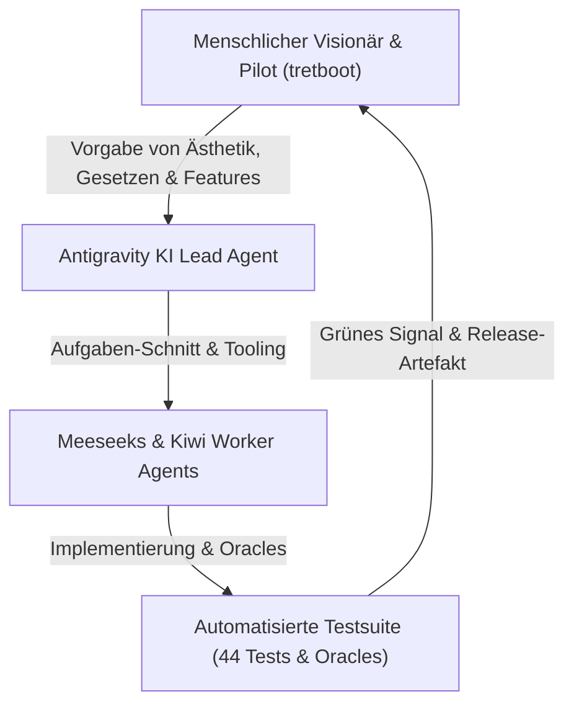

# Arbeitsweise Mensch & KI-Schwarm (Cooperation & Workflow)

STRUDELFORCE ist ein kollaboratives Großprojekt, das im symbiotischen Verbund aus **menschlicher Vision (Human-in-the-Loop)** und einem **autonomen KI-Agenten-Cluster** entwickelt wird.

Dieses Dokument dient als Arbeitsvertrag, Methoden-Leitfaden und Verhaltenskodex für alle menschlichen Entwickler und autonomen KI-Agenten, die an diesem Projekt arbeiten.

---

## 1. Die Rollenverteilung: Human-in-the-Loop

- **Der Mensch (`tretboot`):** Bestimmt die kreative Richtung, das Amiga-500-Spielgefühl, die musikalische Ästhetik (Chris Hülsbeck, Turrican II, Manfred Trenz) und die Einhaltung der 3 Eisernen Gesetze.
- **Die KI-Agenten:** Setzen Features in sauberem C89/C99 um, garantieren 16.16 Fixed-Point-Präzision, pflegen die Oracles und bauen die Binaries für Amiga und PC.

---

## 2. Die Meeseeks-Philosophie (Iteratives Arbeiten)

1. **Jeder Agenten-Einsatz ist eine Iteration:** Ein Agent wird mit einer präzisen, abgegrenzten Mission gerufen.
2. **Keine halben Sachen:** Ein Auftrag endet erst, wenn der Code kompiliert, alle Tests (`test_suite.exe`, `tools/selftest.py`, `verify_core_sim.py`) grün sind und die Dokumentation synchronisiert ist.
3. **Logbuch-Pflicht (`captains_log.md`):** Nach jeder Mission wird das Forschungstagebuch gepflegt: Was lief gut (Muster, Flags), was lief schief (Sackgassen, Compiler-Fallen), welche Entscheidungen wurden getroffen.
4. **Handoff-Integrität:** Der Zustand wird vor der Übergabe an den nächsten Agenten so hinterlassen, dass dieser sofort nahtlos weiterarbeiten kann.

---

## 3. Die 4 Goldenen Regeln für Cloud-Sandboxen (Kiwi Survival Guide)

Wenn Agenten in isolierten Cloud-Sandboxen (ohne Compiler oder mit limitierten Ressourcen) arbeiten:

1. **Strikte Aufgaben-Begrenzung:** Externe Tasks strikt auf maximal 2–3 isolierte Dateien beschränken (1 Spezifikation, 1 C-Datei, 1 Python-Test). Niemals das gesamte Repo auf einmal in eine Sandbox pumpen!
2. **Zero-GCC = Trace-First Python Oracles:** Wenn in einer Sandbox kein C-Compiler existiert, wird niemals blind geraten. Stattdessen werden bit-identische Python-Oracles (`tools/tfmx_oracle.py`, `tools/mod_oracle.py`, `verify_core_sim.py`) ausgeführt, um die Logik mathematisch zu beweisen.
3. **Mega-Atomic-Calls statt Chat-Dumps:** Vollständige Dateien atomar schreiben. Niemals Code in 50 kleinen Snippets im Chat zerstückeln.
4. **Nur ZIPs zählen beim Handoff:** Dateien immer über den geprüften Packer `tools/kiwi_handoff.py pack` austauschen.

---

## 4. Trace-First Verifikation (Oracles vor C-Änderungen)

Bevor und nachdem eine C-Funktion in Audio, Physik oder Parsern modifiziert wird, muss der Python-Oracle-Spiegel ausgeführt werden:

| Subsystem | C-Implementierung | Python-Oracle (Wächter) |
|---|---|---|
| 50Hz Physik & Kampagne | `src/game_logic.c` | `verify_core_sim.py` |
| Chris Hülsbeck TFMX | `src/soundengine_core.c` | `tools/tfmx_oracle.py` |
| ProTracker MOD Replay | `src/soundengine_core.c` | `tools/mod_oracle.py` |
| Strudel Cleanroom AST | `src/soundengine_core.c` | `tools/selftest.py` |
| Level Chunks & Roguelike | `src/level_engine.c` | `levelkit/lv2.py` / `selftest.py` |

Wenn ein Oracle rot anzeigt, darf kein Commit erfolgen. C-Code und Python-Oracle müssen synchron gehalten werden.

---

## 5. Dual-Toolchain & Amiga-Disziplin

- **Keine Standard-C-Bibliothek im Amiga-Kern:** `amiga/main.c` und der M68K-Pfad dürfen kein `stdio.h` (`printf`, `fopen`, `malloc`) verwenden. Alle Ein-/Ausgaben laufen direkt über Custom-Chips (Copper, Blitter, CIA-A, Paula).
- **Dual-Toolchain-Kompatibilität:**
  1. `m68k-amiga-elf-gcc`: Bartman GCC 15.1.0 Toolchain für VS Code und lokale Entwicklung.
  2. `m68k-amigaos-gcc`: Bebbo / GCC Toolchain für Linux und GitHub Actions CI.

