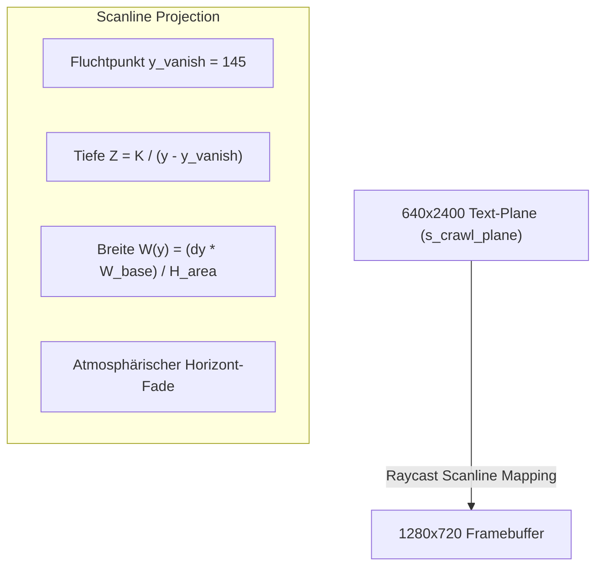

# Level Engine v2 & Voxel-Pipeline

Die Grafik- und Level-Architektur von STRUDELFORCE kombiniert retro 2.5D-Voxel-Ästhetik mit einer modernen modularen Chunk-Engine.

---

## 1. Die 2.5D Voxel-Engine (Zero-Float!)

Gemäß **Gesetz 2** werden Voxel niemals mit Pixel-Texturen überzogen. Plastizität und räumliche Tiefe entstehen rein durch Mathematik und Beleuchtung:

- **Zero-Float:** Die gesamte Transformation, Extrusion und Parallaxe wird in 16.16 Fixed-Point berechnet.
- **Directional Face-Shading:** Voxel-Kanten und Unterseiten werden automatisch abgedunkelt (Oberseite = 100% Palette, Front = 75%, Seiten = 60%, Unterseite = 40%).
- **4 Parallax-Ebenen:**
  - Layer 3 (`z = -20`): Deep-Sky & Copper-Farbverläufe (Amiga Copper-Bänder).
  - Layer 2 (`z = -6`): Mid-Background Ruinensäulen mit 1/4 Parallax-Scroll.
  - Layer 1 (`z = 0`): Gameplay-Ebene (Spieler, Gegner, Schüsse, Kristalle, Truhen).
  - Layer 0 (`z = +2`): Vordergrund-Rohre mit 1.5x Scroll-Geschwindigkeit.

---

## 2. Der Star Wars 3D Perspektiv-Crawl

In `gui_main.c` wurde ein mathematisch echter 3D Star Wars Perspektiv-Crawl implementiert:

- **Scanline-Trapezoid Raycasting:** Jede Scanline $y$ auf dem Bildschirm entspricht einer Tiefe $Z = K / dy$ auf einer nach hinten geneigten Ebene.
- **Kontinuierliche Verjüngung:** Keine sprunghaften Skalierungs-Artefakte mehr. Die Buchstaben verjüngen sich stufenlos zum Fluchtpunkt.
- **Atmosphärischer Horizont-Fade:** Der Text blendet weich in das Weltraum-Sternenfeld aus.
- **Schlagschatten:** Jeder Buchstabe besitzt einen weichen Schatten, der die Sterne im Hintergrund leicht abdunkelt.

---

## 3. Level Engine v2 (197 Chunks & 37 Levels)

Die Level-Engine v2 (`src/level_engine.c` / `levels/levels_v2.json`) definiert die Kampagnen- und Roguelike-Welten:

- **197 modulare Chunks:** Plattformen, Gefahrenzonen, vertikale Schächte und Boss-Arenen.
- **37 spielbare Levels:** Eingeteilt in 5 einzigartige Biome:
  1. *Chrome Tempest:* Blitz-Himmel, mechanische Ruinen, Turrican-Ästhetik.
  2. *The Great Bath:* Unterwasser-Kathedrale, Chris Hülsbeck Tribute-Akkord bei Truhenfund.
  3. *Mechanical Hive:* Alien-Bienenstock, Laser-Draht-Fallen.
  4. *Molten Core:* Magma-Kavernen, Hitze-Verzerrung.
  5. *Void Sanctuary:* Weltraum-Schrein, Schwerelosigkeit und Endgegner-Titanen.
- **Deterministischer Roguelike-Generator:** Garantiert bei gleichem Seed bit-identische Level-Strukturen und Truhenplatzierungen.

